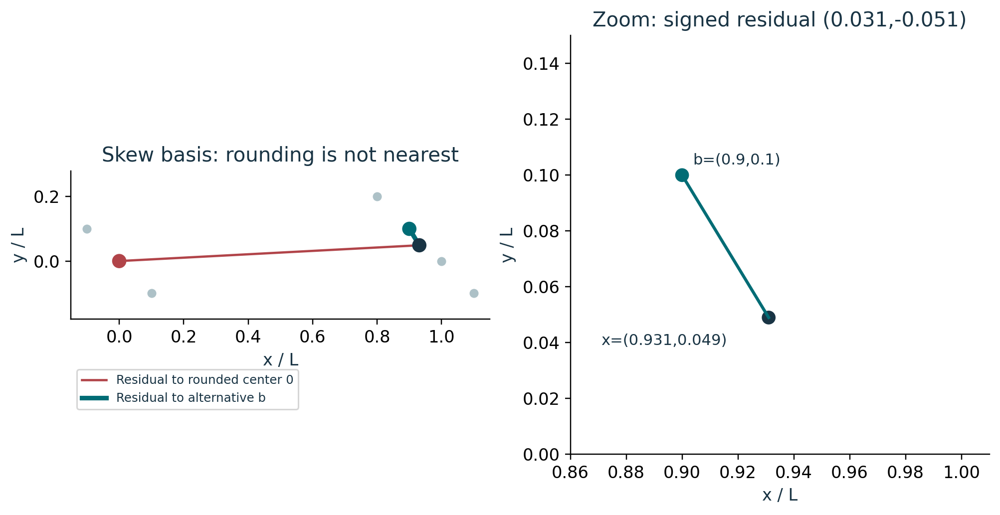
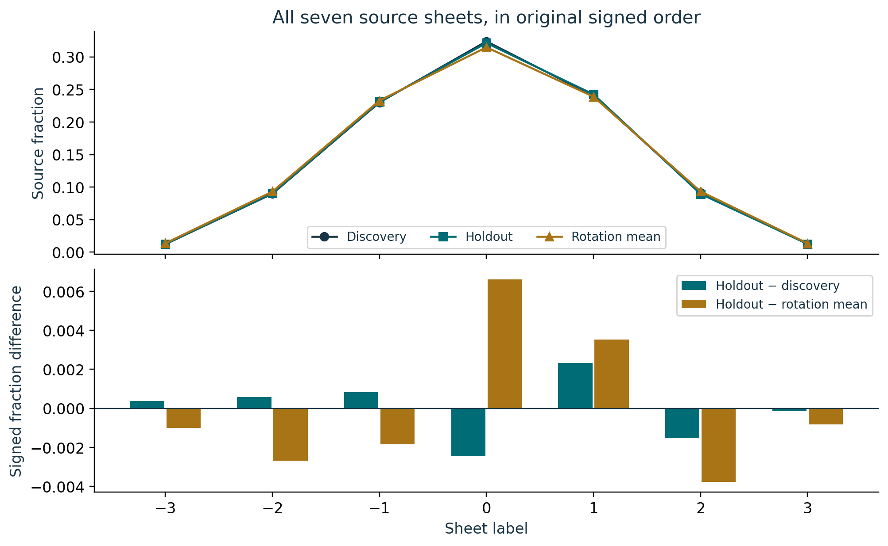
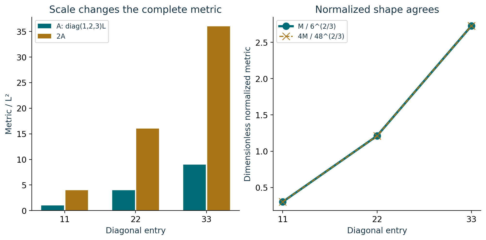

# Course 29: publication visual companion

These publication-added teaching figures accompany the preserved lessons. Numerical illustrations are synthetic unless a caption explicitly identifies a source-defined mathematical object. Plot coordinates are derived from the stated inputs; exact values and source scope remain in the linked lessons.

## Figure 29.1: Skew ownership versus distance

The address q=(0.49,0.49) rounds to (0,0), while x=(0.931,0.049)L is much closer to b=(0.9,0.1)L. The two squared distances are 0.869162 L² and 0.003562 L². Both signed residuals survive. One better candidate disproves a universal rounding rule; this comparison does not certify a global nearest center.

Lesson connection: [3](lesson-03.md), [5](lesson-05.md). Consult those lessons and [source provenance](sources.md) for exact source addresses and evidence classes.

## Figure 29.2: All seven source sheet differences

The lower panel retains both signed comparison vectors across every sheet. The discovery-to-holdout signs are (+,+,+,-,+,-,-). The plotted floating-point view does not replace the exact stored decimal ledger. The full empirical 27-state arrays remain unavailable here, and no missing entries are filled with zero.

Lesson connection: [6](lesson-06.md), [7](lesson-07.md), [8](lesson-08.md). Consult those lessons and [source provenance](sources.md) for exact source addresses and evidence classes.

## Figure 29.3: Scale normalization with volume retained

Doubling each basis column changes volume from 6 L³ to 48 L³, metric entries by four, and roots by two. Division by V^(2/3) removes uniform scale. Keep V and the ordered basis to retain scale, orientation and handedness: the normalized metric alone cannot recover them. The result does not supply a physical calibration between the galaxy reconstruction and nanometre Cell3.

Lesson connection: [4](lesson-04.md), [5](lesson-05.md), [8](lesson-08.md). Consult those lessons and [source provenance](sources.md) for exact source addresses and evidence classes.
