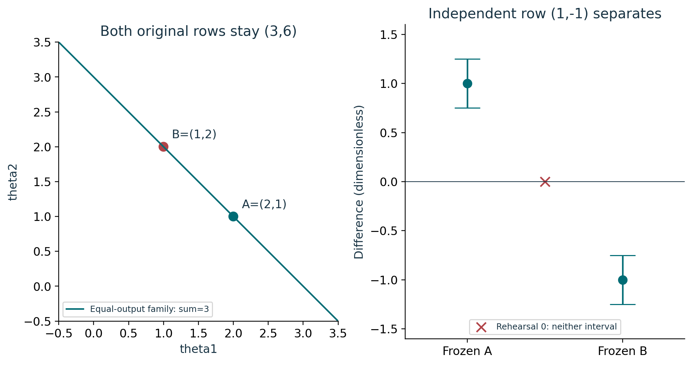
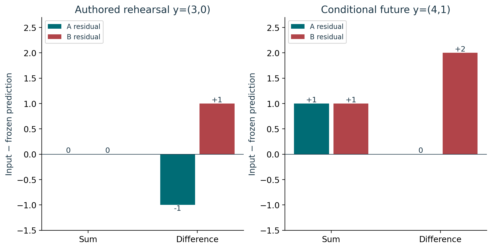
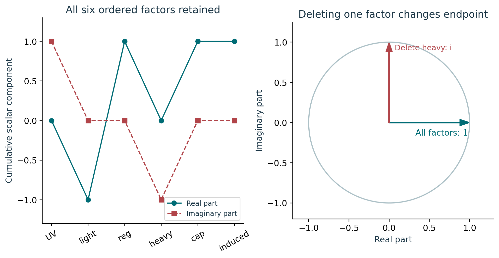

# Course 30: publication visual companion

These publication-added teaching figures accompany the preserved lessons. Numerical illustrations are synthetic unless a caption explicitly identifies a source-defined mathematical object. Plot coordinates are derived from the stated inputs; exact values and source scope remain in the linked lessons.

## Figure 30.1: Invisible direction and discriminator

The parameter direction (1,-1) leaves both original rows unchanged. A calibrated difference row would recover the second independent combination. Its frozen predictions +1 and -1 have disjoint toy intervals. A numeric zero is a mismatch with both; an absent difference row is undefined instead. Actual calibration must establish the physical row and bounds.

Lesson connection: [3](lesson-03.md), [4](lesson-04.md), [5](lesson-05.md). Consult those lessons and [source provenance](sources.md) for exact source addresses and evidence classes.

## Figure 30.2: Every candidate residual retained

A keeps p=(3,1), B keeps p=(3,-1). The four residual vectors are (0,-1), (0,+1), (1,0), (1,2), and each reconstructs its panel’s input with its own frozen prediction. The zero entries remain visible. A separate known-reference response can distinguish transfer change from a changed underlying contribution.

Lesson connection: [5](lesson-05.md), [6](lesson-06.md), [7](lesson-07.md). Consult those lessons and [source provenance](sources.md) for exact source addresses and evidence classes.

## Figure 30.3: Six phase factors and omission

The ordered factors (i,i,-1,-i,i,1) give cumulative products (i,-1,1,-i,1,1). Removing heavy changes the final product to i. This verifies the stated scalar multiplication, not the existence of a global trivialization. Source domains, topology and admitted sectors travel separately with the determinant-line claim.

Lesson connection: [2](lesson-02.md), [7](lesson-07.md), [8](lesson-08.md). Consult those lessons and [source provenance](sources.md) for exact source addresses and evidence classes.
